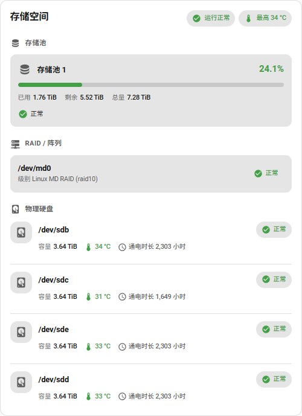
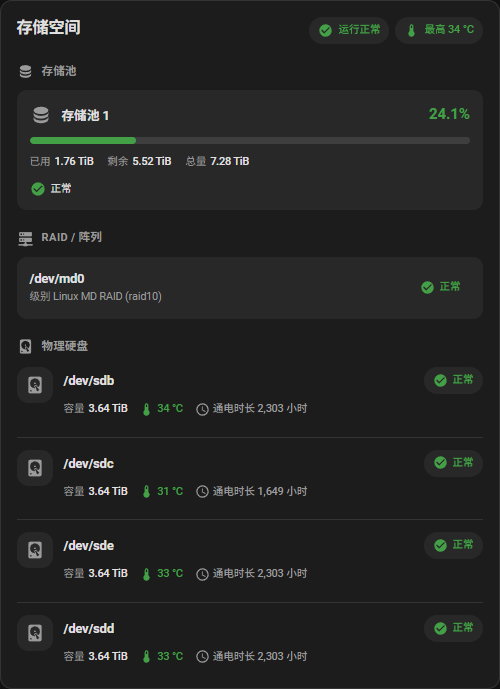

# Storage Monitor Card

[](https://github.com/hacs/integration)
[](https://github.com/fissssssh/storage-monitor-card/releases)
[](LICENSE)

A configurable Home Assistant Lovelace custom card for storage pools, RAID arrays and physical disks. It is designed to visually fit Home Assistant's Mushroom-style dashboards without depending on Mushroom internals.

## Preview

| Light theme | Dark theme |
| :---: | :---: |
|  |  |

The screenshots above are taken in Home Assistant; the card follows the Home Assistant language and theme.

## Features

- Multiple storage pools with used/free/total capacity and usage percentage.
- RAID state, health and rebuild/sync progress.
- Multiple physical disks with capacity, usage, temperature, health and optional model.
- Configurable warning and critical thresholds.
- English and Simplified Chinese UI text; follows the Home Assistant language by default, with an explicit `language` option.
- Follows Home Assistant themes through CSS variables.
- Optional sections; missing entities degrade gracefully.
- YAML configuration and a basic visual editor.
- No vendor-specific integration or backend dependency.

## Installation

The card works with the built-in **Marketplace** in Home Assistant 2026.11 and newer, and with **HACS** on Home Assistant 2026.10 and older.

[](https://my.home-assistant.io/redirect/hacs_repository/?owner=fissssssh&repository=storage-monitor-card&category=plugin)

### Marketplace (Home Assistant 2026.11+)

Storage Monitor Card is not part of the catalog yet, so add it from its GitHub link first:

1. Go to **Settings → Marketplace**.
2. In the upper-right corner, select **Add from link**.
3. Enter `https://github.com/fissssssh/storage-monitor-card` and select **Add**. If the type is not detected, choose **Dashboard**.
4. Open **Storage Monitor Card** in the list and select **Install**.
5. Reload your browser to load the dashboard resource.

The Marketplace installs the card into `www/community/storage-monitor-card/` and adds the dashboard resource automatically. If you manage resources in YAML, add the resource shown in the install dialog — see [Dashboard resources](#dashboard-resources) below.

### HACS (Home Assistant 2026.10 and older)

1. Install [HACS](https://hacs.xyz/) if you have not already.
2. Open **HACS → Dashboard**.
3. Open the three-dot menu in the top right corner and choose **Custom repositories**.
4. Add `https://github.com/fissssssh/storage-monitor-card` with category **Dashboard**.
5. Search for **Storage Monitor Card**, open it and click **Download**.
6. Reload Home Assistant when prompted.

### Dashboard resources

Marketplace and HACS register the dashboard resource automatically. If you manage dashboard resources in YAML, or the card does not show up in the card picker, add it under **Settings → Dashboards → Resources**:

| Home Assistant | URL | Resource type |
|---|---|---|
| 2026.11+ (Marketplace) | `/local/community/storage-monitor-card/storage-monitor-card.js` | JavaScript module |
| 2026.10 and older (HACS) | `/hacsfiles/storage-monitor-card/storage-monitor-card.js` | JavaScript module |

### Manual

1. Download `storage-monitor-card.js` from the [latest release](https://github.com/fissssssh/storage-monitor-card/releases/latest).
2. Copy it to `/config/www/storage-monitor-card.js` (create the `www` directory if needed).
3. Go to **Settings → Dashboards → Resources** and add:

| URL | Resource type |
|---|---|
| `/local/storage-monitor-card.js` | JavaScript module |

4. Reload Home Assistant.

### From source

```bash
npm install
npm run build
```

Install `dist/storage-monitor-card.js` the same way as the manual method.

## Example configuration

```yaml
type: custom:storage-monitor-card
title: Storage
subtitle: NAS · Storage Overview

pools:
  - name: Main pool
    total: sensor.pool_total
    used: sensor.pool_used
    free: sensor.pool_free
    usage: sensor.pool_usage
    health: sensor.pool_health
    raid: sensor.pool_raid

raid:
  name: Main array
  level: sensor.raid_level
  state: sensor.raid_state
  health: sensor.raid_health
  progress: sensor.raid_rebuild_progress

disks:
  - name: Disk 1
    capacity: sensor.disk_1_capacity
    used: sensor.disk_1_used
    free: sensor.disk_1_free
    usage: sensor.disk_1_usage
    temperature: sensor.disk_1_temperature
    powerOnHours: sensor.disk_1_power_on_hours
    health: sensor.disk_1_health
    model: sensor.disk_1_model

  - name: Disk 2
    capacity: sensor.disk_2_capacity
    temperature: sensor.disk_2_temperature
    health: sensor.disk_2_health

showPools: true
showRaid: true
showDisks: true
showTemperature: true
showHealth: true

warningThreshold: 75
criticalThreshold: 90
temperatureWarning: 45
temperatureCritical: 55
entityTapAction: more-info
```

## Localization

All built-in UI text is translated by the card; entity states are not altered. The card **follows the Home Assistant language by default** and falls back to English for languages it does not ship yet.

| `language` | Result |
|---|---|
| not set, or `auto` | Follow the Home Assistant UI language (default); English when that language is not supported |
| `en` | Always English |
| `zh-Hans` | Always Simplified Chinese. `zh`, `zh-CN`, `zh-SG`, … are treated the same way |

Titles and names you set yourself (`title`, `subtitle`, pool/disk/raid `name`) are always shown as written; when `title` is omitted, a translated default (`Storage` / `存储空间`) is used. Health values such as `healthy`, `degraded`, `failed`, `正常`, and `故障` are classified by the card and then translated, so vendor-specific states still display with the right colour and badge. Numbers, capacities and temperatures are formatted with the locale of the active language.

## Configuration reference

### Pool item

| Key | Required | Description |
|---|---:|---|
| `name` | no | Display name |
| `total` | no | Total capacity entity |
| `used` | no | Used capacity entity |
| `free` | no | Free capacity entity |
| `usage` | no | Usage percentage entity (0–100) |
| `raid` | no | Optional RAID label/state entity |
| `health` | no | Health entity |
| `icon` | no | MDI icon, e.g. `mdi:database` |

### Disk item

| Key | Required | Description |
|---|---:|---|
| `name` | no | Display name |
| `capacity` | no | Capacity entity |
| `used` | no | Used capacity entity |
| `free` | no | Free capacity entity |
| `usage` | no | Usage percentage entity (0–100) |
| `temperature` | no | Temperature entity |
| `powerOnHours` | no | Power-on hours / SMART Power_On_Hours entity (displayed in hours) |
| `health` | no | Health entity |
| `model` | no | Model/name entity |
| `serial` | no | Reserved for future display |
| `icon` | no | MDI icon |

### RAID object

| Key | Description |
|---|---|
| `name` | Display name |
| `level` | RAID level entity |
| `state` | RAID state entity |
| `health` | Health entity |
| `progress` | Rebuild/sync percentage entity (0–100) |
| `icon` | MDI icon (reserved) |

### Global options

| Key | Default | Description |
|---|---:|---|
| `showPools` | `true` | Show pools |
| `showDisks` | `true` | Show disks |
| `showRaid` | `true` | Show RAID section |
| `showTemperature` | `true` | Show disk temperatures |
| `showHealth` | `true` | Show health badges |
| `showEmptySections` | `false` | Show unconfigured sections |
| `compact` | `false` | Reduce spacing |
| `warningThreshold` | `75` | Usage warning percentage |
| `criticalThreshold` | `90` | Usage critical percentage |
| `temperatureWarning` | `45` | Temperature warning in °C |
| `temperatureCritical` | `55` | Temperature critical in °C |
| `entityTapAction` | `more-info` | `more-info` or `none` |
| `language` | `auto` | UI language: `auto` (follow Home Assistant, default), `en`, or `zh-Hans` |

## Notes

- This card visualizes entities; it does not collect SMART, RAID or storage metrics itself. Install and configure the relevant Home Assistant integration/add-on first.
- Capacity values are automatically scaled to the largest suitable unit using each entity's `unit_of_measurement` (for example, B → GiB/TiB and GiB → TiB; SI units retain the KB/MB/GB/TB family).
- `powerOnHours` should point to a numeric sensor whose value is the disk's accumulated power-on time in hours. The card renders the value with a localized unit suffix (`1,234 h` in English, `1,234 小时` in Chinese).
- Usage sensors must report a percentage from 0 to 100.
- Health text is classified heuristically from common values such as `healthy`, `normal`, `degraded`, `failed`, `warning`, `正常`, and `故障`, then displayed in the configured language. Unknown vendor-specific values are shown neutrally.
- The visual editor currently edits pool, disk and RAID mappings as JSON. YAML mode is recommended for advanced configuration.

## Development

```bash
npm run dev
npm run build
```

## License

MIT
